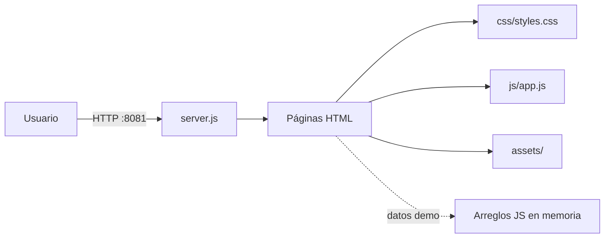
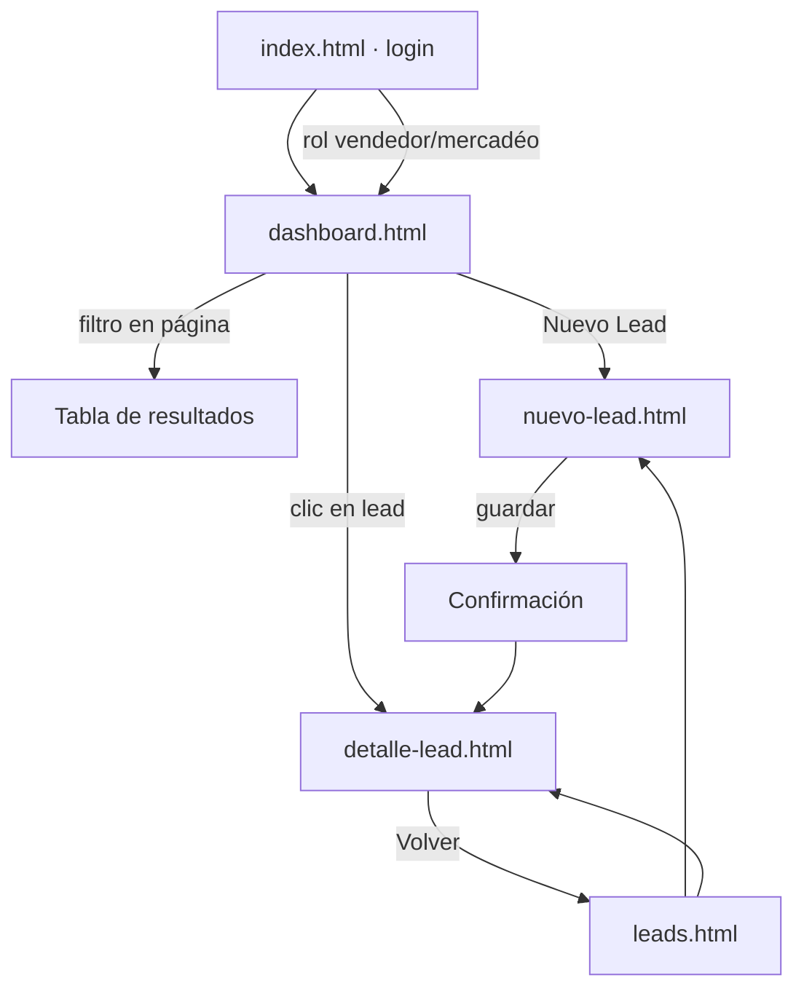

# Documentación técnica · CRAISA Leads

Versión 1.0 · Octubre 2026

## 1. Resumen ejecutivo

El proyecto implementa el Sistema de Gestión y Seguimiento de Leads Comerciales de CRAISA. La entrega actual es un **prototipo funcional estático** que valida la identidad visual, los flujos comerciales y la experiencia de uso con datos ficticios. La versión productiva se construirá con Next.js 15, Prisma y Auth.js v5 sobre PostgreSQL.

| Aspecto | Prototipo actual | Versión productiva |
| --- | --- | --- |
| Frontend | HTML5 + CSS3 + JavaScript ES6 | Next.js 15 App Router + TypeScript |
| Estilos | Design system propio en `css/styles.css` | Tailwind CSS + shadcn/ui |
| Datos | Arreglos en memoria por página | Prisma + SQLite (dev) / PostgreSQL (prod) |
| Autenticación | Validación simulada en cliente | Auth.js v5, sesión y hash de contraseña |
| Roles | Sesión simulada | Middleware y políticas por rol |
| Exportación | CSV generado en el navegador | Route Handler con streaming |
| Despliegue | Servidor estático local | Vercel o contenedor + PostgreSQL |

## 2. Objetivos y alcance

### 2.1 Objetivos

1. Centralizar los leads de los nueve canales en un solo registro.
2. Estandarizar el seguimiento con siete estados y una bitácora auditable.
3. Dar visibilidad comercial por estado, canal, línea y periodo.
4. Reducir la pérdida de oportunidades por falta de próxima acción.
5. Exportar información compatible con Excel para análisis externo.

### 2.2 Fuera de alcance (esta fase)

- Integraciones reales con WhatsApp Business, Meta, correo o ERP.
- Envío automático de correos o mensajes.
- Facturación, cotizaciones firmadas o inventario.
- Aplicación móvil nativa.
- Persistencia y multiusuario concurrente.

## 3. Arquitectura actual

Aplicación de páginas estáticas independientes, sin build ni dependencias de ejecución. `server.js` es un servidor HTTP mínimo que sirve archivos y elimina el query string antes de resolver la ruta, necesario para URLs como `detalle-lead.html?code=LEAD-2026-0142`.



### 3.1 Archivos principales

| Archivo | Responsabilidad |
| --- | --- |
| `index.html` | Login simulado, validación y redirección por rol |
| `dashboard.html` | KPIs, filtros en página, funnel, dona, canales, equipo, actividad |
| `leads.html` | Tabla, búsqueda, filtros combinados, paginación, selección múltiple, CSV |
| `detalle-lead.html` | Ficha, próxima acción, cambio de estado, bitácora, historial, notas |
| `nuevo-lead.html` | Formulario, validación, detección de duplicados, confirmación |
| `css/styles.css` | Tokens de marca, layout, componentes y responsive |
| `js/app.js` | Notificaciones, animaciones de entrada, utilidades compartidas |
| `server.js` | Servidor estático con resolución de rutas |

### 3.2 Flujo de navegación



## 4. Identidad visual y design system

La paleta y tipografía provienen del Libro de Marca CRAISA 2025.

### 4.1 Tokens

| Token | Valor | Uso |
| --- | --- | --- |
| `--craisa-primary` | `#143F7F` | Color corporativo, botones, enlaces, focos |
| `--craisa-primary-deep` | `#0B2450` | Fondos oscuros y degradados |
| `--line-agricola` | `#AA182C` | Línea Agrícola y alertas |
| `--line-construccion` | `#D47E00` | Línea Construcción |
| `--line-carga` | `#3DAE2B` | Movimiento de Carga y resultados positivos |
| `--line-precision` | `#004B70` | Agricultura de Precisión |
| `--line-postventa` | `#58595B` | Postventa y Repuestos |
| `--line-institucional` | `#143F7F` | Administrativo / Institucional |
| `--bg-page` | `#F0F2F5` | Fondo general |
| `--bg-card` | `#FFFFFF` | Tarjetas y tablas |
| `--text-primary` | `#111827` | Texto principal |
| `--text-secondary` | `#4B5563` | Texto de apoyo |
| `--text-tertiary` | `#6B7280` | Metadatos y etiquetas |

Tipografías: **Archivo** para títulos y cifras (700–800), **Inter** para texto e interfaz (400–600).

### 4.2 Reglas de interfaz

- Tarjetas blancas con borde `1px` y radio de 6–8 px.
- Hover con borde azul corporativo y halo de 1 px; sin sombras exageradas.
- Títulos de sección en mayúsculas con línea corta azul (clase `.eyebrow`).
- Un solo gráfico de barras (estado); una dona (línea de negocio); funnel y tarjetas para el resto.
- KPIs en una fila flexible que se envuelve en pantallas pequeñas.
- Sin cajas de avatar junto a nombres en equipo y actividad.
- Pie de página con logotipo horizontal de 28 px y sin la razón social completa.

## 5. Modelo de datos

El esquema Prisma está en `prisma/schema.prisma` y el diccionario completo en `docs/modelo-datos.md`. Entidades: `User`, `Lead`, `Interaction`, `Task`, `Tag`, `LeadTag`, `AuditLog`.

Decisiones relevantes:

- **Portabilidad.** Los catálogos se guardan como `String` para no depender de enums de PostgreSQL durante el desarrollo con SQLite. La validación vive en Zod.
- **Código visible.** `Lead.code` es único y legible; `id` es interno.
- **Trazabilidad.** Cada cambio de estado genera un `Interaction` y un `AuditLog`.
- **Borrado.** En producción se recomienda borrado lógico (`deletedAt`) en lugar de `DELETE`.
- **Montos.** `estimatedValue` se almacena como entero en colones para evitar errores de punto flotante.

## 6. Diseño de la aplicación Next.js

### 6.1 Estructura propuesta

```
src/
├── app/
│   ├── (auth)/login/page.tsx
│   ├── (app)/layout.tsx
│   ├── (app)/dashboard/page.tsx
│   ├── (app)/leads/page.tsx
│   ├── (app)/leads/[id]/page.tsx
│   ├── (app)/leads/nuevo/page.tsx
│   ├── api/leads/route.ts
│   ├── api/leads/[id]/route.ts
│   ├── api/leads/export/route.ts
│   └── api/dashboard/route.ts
├── components/
│   ├── ui/                 shadcn/ui
│   ├── leads/              tabla, filtros, formulario, badges
│   └── dashboard/          kpis, funnel, dona, canales
├── lib/
│   ├── auth.ts             configuración Auth.js
│   ├── prisma.ts           cliente singleton
│   ├── validations.ts      esquemas Zod
│   ├── csv.ts              serialización compatible con Excel
│   └── permissions.ts      reglas por rol
├── prisma/
│   ├── schema.prisma
│   └── seed.ts
└── middleware.ts           protección de rutas
```

### 6.2 Rutas y contratos

| Método | Ruta | Descripción | Roles |
| --- | --- | --- | --- |
| `GET` | `/api/leads` | Listado paginado con `q`, `status`, `channel`, `line`, `owner`, `from`, `to` | Todos |
| `POST` | `/api/leads` | Crear lead; devuelve `code` | ADMIN, VENDEDOR, MERCADEO |
| `GET` | `/api/leads/:id` | Ficha con bitácora y tareas | Según visibilidad |
| `PATCH` | `/api/leads/:id` | Editar datos, estado, responsable, score | ADMIN, dueño |
| `DELETE` | `/api/leads/:id` | Borrado lógico | ADMIN |
| `POST` | `/api/leads/:id/interactions` | Agregar nota o cambio de estado | ADMIN, dueño |
| `POST` | `/api/leads/:id/tasks` | Crear o reprogramar próxima acción | ADMIN, dueño |
| `GET` | `/api/leads/export` | CSV con los filtros activos | Todos |
| `GET` | `/api/dashboard` | Métricas agregadas por periodo | Todos |

Respuesta de error uniforme:

```json
{
  "error": "VALIDATION_ERROR",
  "message": "El teléfono debe tener 8 dígitos",
  "fields": { "phone": "Formato inválido" }
}
```

### 6.3 Autenticación y permisos

- Auth.js v5 con credenciales y `bcrypt` (12 rondas).
- Sesión JWT con `role`, `line` y `userId`.
- `middleware.ts` redirige a `/login` si no hay sesión y bloquea rutas de administración.
- Regla de visibilidad centralizada en `lib/permissions.ts`:

```ts
export function canViewLead(user: SessionUser, lead: Lead) {
  if (user.role === "ADMIN" || user.role === "MERCADEO") return true;
  return lead.responsableId === user.id;
}

export function canEditLead(user: SessionUser, lead: Lead) {
  if (user.role === "ADMIN") return true;
  if (user.role === "MERCADEO") return false;
  return lead.responsableId === user.id;
}
```

- Las rutas de API repiten la verificación: nunca se confía solo en la interfaz.
- Rate limiting en login (5 intentos por 15 minutos por IP y correo).

### 6.4 Validación

Esquemas Zod compartidos entre formulario y API:

```ts
export const leadSchema = z.object({
  firstName: z.string().min(2).max(80),
  company: z.string().max(120).optional(),
  phone: z.string().regex(/^(\+506)?\s?\d{4}-?\d{4}$/),
  email: z.string().email().optional(),
  channel: z.enum(["web","facebook","instagram","whatsapp","llamada","correo","feria","visita","otro"]),
  businessLine: z.enum(["agricola","construccion","carga","precision","postventa","administrativo"]),
  description: z.string().max(1000).optional(),
  estimatedValue: z.number().int().nonnegative().optional(),
  responsableId: z.string().cuid().optional(),
});
```

Reglas adicionales: correo obligatorio para `web` y `correo`; fecha de ingreso no futura; motivo obligatorio al pasar a `perdido`.

### 6.5 Generación del código

```ts
const year = new Date().getFullYear();
const last = await tx.lead.findFirst({
  where: { code: { startsWith: `LEAD-${year}-` } },
  orderBy: { code: "desc" },
  select: { code: true },
});
const next = last ? Number(last.code.slice(-4)) + 1 : 1;
const code = `LEAD-${year}-${String(next).padStart(4, "0")}`;
```

La consulta y la inserción deben ejecutarse dentro de `prisma.$transaction` para evitar colisiones.

### 6.6 Exportación CSV

- Separador coma, comillas dobles y escape de comillas internas.
- BOM `\uFEFF` al inicio para Excel en Windows.
- `Content-Type: text/csv; charset=utf-8` y `Content-Disposition: attachment`.
- En producción, generar por streaming para volúmenes mayores a 10 000 filas.

## 7. Rendimiento y accesibilidad

- Objetivo: primera pintura útil menor a 2 s en red corporativa.
- Paginación de 10–25 registros; índices en estado, responsable y fecha.
- Imágenes con `width`/`height` y formatos modernos; logotipo en PNG optimizado.
- Contraste mínimo AA: texto principal `#111827` sobre blanco; textos terciarios se reservan para metadatos.
- Navegación por teclado en formularios, modales con foco atrapado y cierre con `Esc`.
- Etiquetas `aria-label` en iconos interactivos; estados de error asociados con `aria-describedby`.

## 8. Seguridad

| Riesgo | Mitigación |
| --- | --- |
| Acceso indebido a cartera ajena | Verificación de permisos en cada consulta y mutación |
| Fuerza bruta en login | Rate limiting, bloqueo temporal, registro de intentos |
| Inyección SQL | Prisma parametriza las consultas |
| XSS | Escape por defecto de React; nunca `dangerouslySetInnerHTML` con datos de usuario |
| CSV injection | Prefijar con apóstrofo celdas que inicien con `=`, `+`, `-`, `@` |
| Datos sensibles en logs | No registrar teléfono ni correo completos |
| Borrado accidental | Borrado lógico, confirmación y auditoría |

## 9. Pruebas

Ver `docs/pruebas-y-limitaciones.md`. Incluye pruebas funcionales del prototipo, validación de sintaxis, carga de páginas en DOM simulado y matriz de casos para la fase Next.js.

## 10. Despliegue

### 10.1 Prototipo

```bash
node server.js
# http://localhost:8081
```

### 10.2 Versión Next.js

```bash
# Requisitos: Node 20+, PostgreSQL 15+
npm install
cp .env.example .env
npx prisma migrate dev
npm run seed
npm run dev
```

Variables de entorno:

```env
DATABASE_URL="file:./dev.db"          # SQLite en desarrollo
# DATABASE_URL="postgresql://..."     # PostgreSQL en producción
AUTH_SECRET="cadena-aleatoria-de-32-bytes"
AUTH_URL="http://localhost:3000"
```

Producción: Vercel para la aplicación y PostgreSQL administrado (Neon, Supabase o RDS). Configurar respaldo diario, monitoreo de errores y alertas de latencia.

## 11. Plan de migración

| Fase | Entregable | Criterio de cierre |
| --- | --- | --- |
| 1. Fundación | Next.js, Tailwind, shadcn/ui, layout y navegación | Identidad visual equivalente al prototipo |
| 2. Datos | Prisma, migraciones, seed y API de leads | CRUD completo con validación |
| 3. Autenticación | Auth.js, roles y middleware | Cada rol ve solo lo permitido |
| 4. Tablero | Métricas reales, filtros y exportación | Cifras conciliadas con la base |
| 5. Calidad | Pruebas, accesibilidad y carga | Cobertura crítica y checklist AA |
| 6. Piloto | Despliegue, capacitación y retroalimentación | Aprobación de CRAISA |

## 12. Riesgos y decisiones abiertas

1. **Volumen inicial.** Si supera 50 000 leads, evaluar partición por año o archivado.
2. **Duplicados.** La regla de 90 días debe validarse con CRAISA; podría ampliarse a 180.
3. **Integración futura con WhatsApp.** Requiere API oficial y consentimiento del cliente; no se incluye en el piloto.
4. **Comisiones.** El valor estimado y el responsable alimentan reportes, pero el cálculo de comisiones queda fuera.
5. **Retención de datos.** Definir política con Recursos Humanos y Legal antes de producción.

---

CRAISA 2026 · Documento técnico del prototipo y plan de implementación.
