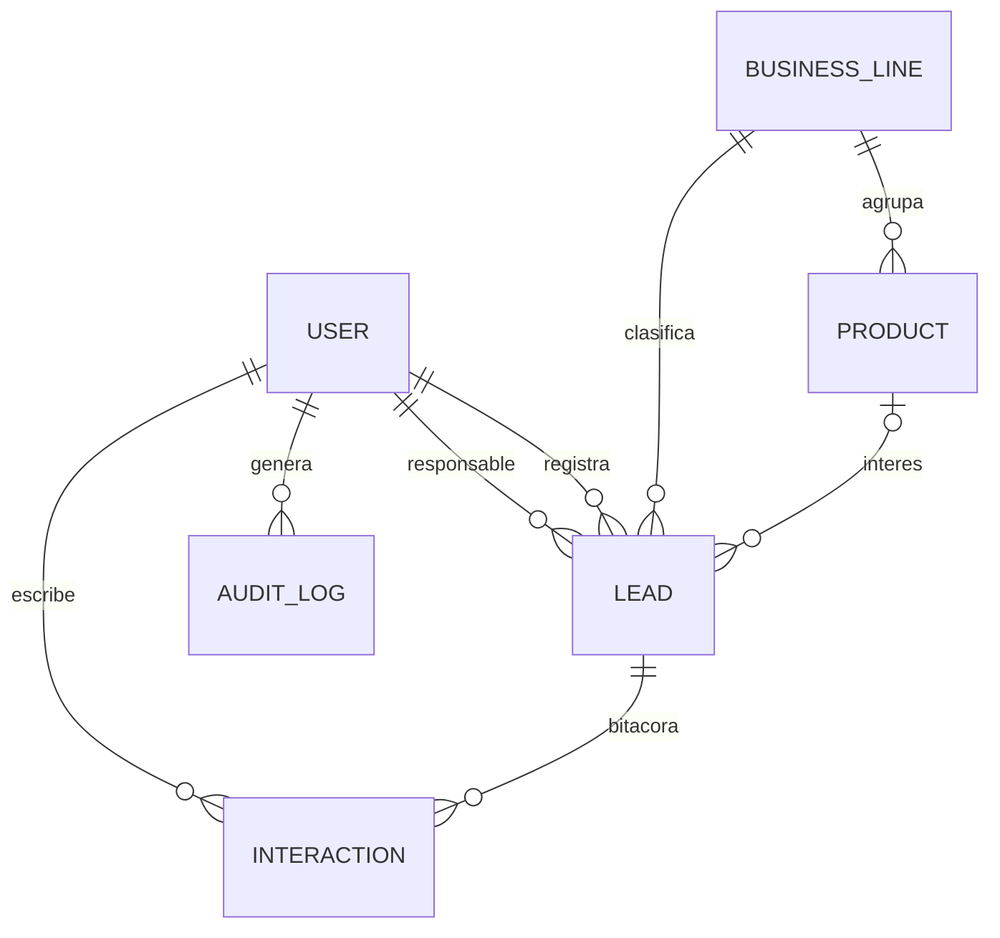

# Modelo de datos

PostgreSQL con Prisma. El esquema fuente es `apps/api/prisma/schema.prisma` y las migraciones estan en `apps/api/prisma/migrations/`.

## Tablas

| Tabla | Campos principales | Proposito |
|---|---|---|
| `users` | id, name, email (unico), passwordHash, role, active | Usuarios internos y su rol. Desactivar corta el acceso de inmediato. |
| `business_lines` | id, name (unico), active | Lineas de negocio. Las define Mercadeo; el seed trae ejemplos. |
| `products` | id, name, businessLineId, active | Productos de cada linea (unico por linea + nombre). |
| `leads` | ver detalle abajo | Consulta comercial. |
| `interactions` | id, leadId, userId, type, content, fromStatus, toStatus, createdAt | Bitacora: creacion, notas, cambios de estado y reasignaciones. |
| `lead_sequences` | year, last | Ultimo numero usado por anio: los codigos nunca se repiten. |
| `audit_logs` | id, userId, action, detail, createdAt | Ingresos, exportaciones, borrados y cambios de usuarios. |
| `notifications` | id, userId, actorId, leadId, type, message, readAt, createdAt | Avisos de la campana. Nadie recibe aviso de lo que hizo el mismo; las acciones vencidas se calculan, no se guardan. |

### `leads`

| Campo | Tipo | Obligatorio | Nota |
|---|---|---|---|
| code | texto unico | si | `LEAD-AAAA-####`, secuencial por anio |
| entryDate | fecha | si | Fecha de ingreso de la consulta |
| contactName | texto | si | Nombre |
| company | texto | no | Empresa |
| phone / email | texto | al menos uno | Contacto |
| channel | enum Channel | si | Canal de origen |
| businessLineId | FK | si | Linea de negocio |
| productId | FK | no | Debe pertenecer a la linea |
| description | texto | si | Descripcion de la consulta |
| status | enum LeadStatus | si | Por defecto NUEVO |
| assignedToId | FK usuario | si (al registrar) | Responsable |
| createdById | FK usuario | automatico | Quien lo registro |
| nextAction / nextActionAt | texto / fecha | no | Proxima accion; si hay fecha, hay descripcion |
| lossReason | texto | si es PERDIDO | Motivo de perdida |
| autoCaptured | booleano | automatico | Verdadero si el lead entro solo por un canal digital (formulario web) |
| createdAt / updatedAt | fecha-hora | automatico | `updatedAt` es la fecha de ultima actualizacion |

## Enumeraciones

| Enum | Valores |
|---|---|
| `LeadStatus` | NUEVO, ASIGNADO, CONTACTADO, EN_SEGUIMIENTO, OPORTUNIDAD, GANADO, PERDIDO (orden del embudo) |
| `Channel` | CORREO, FACEBOOK, FERIA, INSTAGRAM, LLAMADA, OTRO, SITIO_WEB, VISITA_COMERCIAL, WHATSAPP |
| `Role` | ADMIN, VENDEDOR |
| `InteractionType` | ASIGNACION, CAMBIO_ESTADO, CREACION, NOTA |
| `NotificationType` | ACTIVIDAD, ASIGNACION, LEAD_AUTOMATICO |

Las etiquetas visibles de cada valor estan en `packages/shared/src/enums.ts`.

## Reglas

- **Validacion.** Esta en `packages/shared/src/schemas.ts` y el API la repite en el servidor.
- **Cambios de estado.** Solo entran por `POST /leads/:code/status`. Cada cambio deja una entrada `CAMBIO_ESTADO` con el estado anterior y el nuevo.
- **Fecha de ultima actualizacion.** `updatedAt` cambia con cualquier edicion, cambio de estado o nota.
- **Fechas sin hora.** `entryDate` y `nextActionAt` usan columnas `date`, asi la zona horaria no las desplaza.
- **Borrado de un lead.** Elimina tambien su bitacora y sus notificaciones (cascade).
- **Usuarios.** No se borran: se desactivan, y sus leads conservan la referencia.

## Indices

- **`leads`:** status, channel, businessLineId, assignedToId, entryDate y nextActionAt. Son los campos que usan los filtros y el dashboard.
- **`interactions`:** (leadId, createdAt), para mostrar la bitacora.
